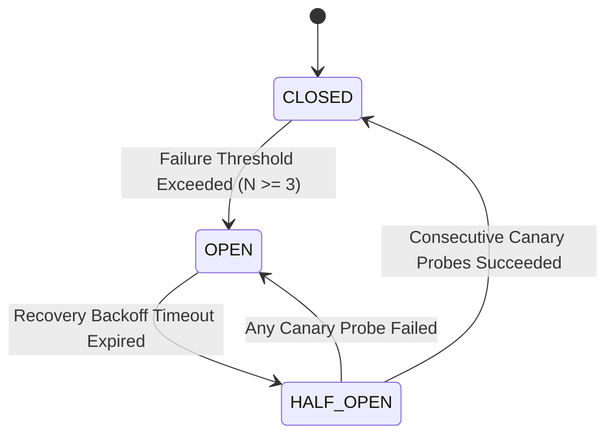
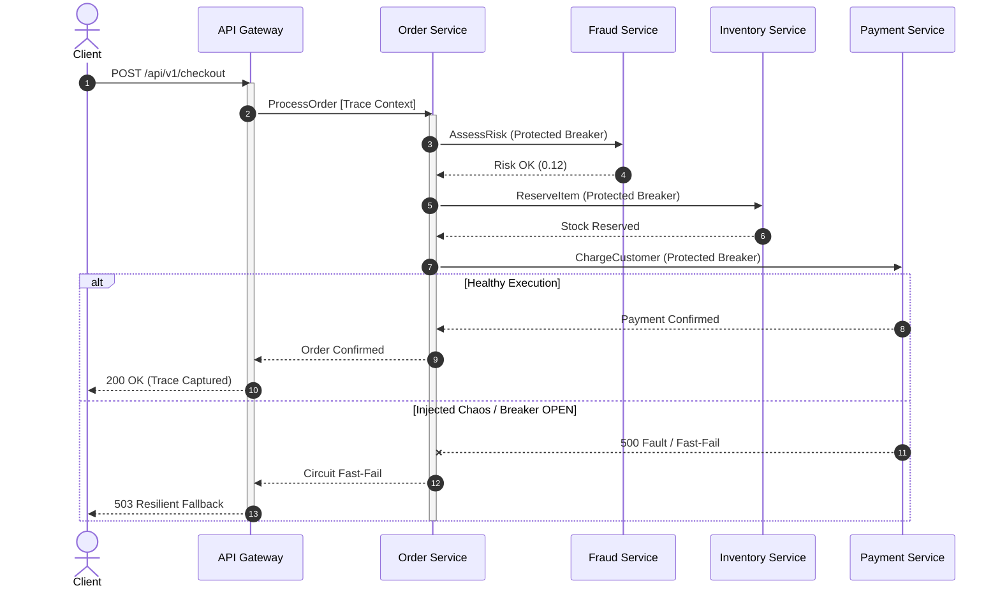

# 🛡️ ChaosMesh Sentinel Observability

> **Enterprise SRE Chaos Engineering Mesh & Distributed Tracing Observability Engine**  
> **Author & Chief Architect:** 🏛️ أ. طارق ابوعشي — استشاري ومعماري هندسة البرمجيات والأنظمة الموزعة

---

## 📌 Architectural Overview

**ChaosMesh Sentinel** is a high-performance Site Reliability Engineering (SRE) framework and distributed observability platform. It empowers cloud-native microservice architectures to proactively evaluate and validate systemic resilience against cascading network partitions, upstream timeouts, and degraded third-party dependencies through controlled chaos experiments, automated circuit breaking, and end-to-end W3C distributed trace propagation.



---

## ⚡ Core Engineering Subsystems

### 1. Finite-State Machine Circuit Breaker (`src/resilience/`)
- Implements the canonical Michael Nygard Circuit Breaker pattern with states:
  - **`CLOSED`**: All traffic passes through to downstream microservices. Failures increment failure counters.
  - **`OPEN`**: Downstream dependency considered degraded. Incoming calls immediately fast-fail (`CircuitBreakerOpenError`), shedding load and allowing recovery.
  - **`HALF_OPEN`**: Canary probes test downstream recovery. If $K$ consecutive requests succeed, the breaker transitions back to `CLOSED`.

### 2. Dynamic Chaos Fault Injector (`src/chaos/`)
- Dynamic latency injection with configurable gaussian or uniform jitter:
  $$\Delta t_{\text{delay}} = t_{\text{base}} + \text{rand}(0, t_{\text{jitter}})$$
- Stochastic error rate fault injection:
  $$\text{Inject Error if } \mathcal{U}(0, 1) < P_{\text{error}}$$
- Blackhole network partition simulation dropping egress traffic without response.

### 3. W3C Distributed Context Tracer (`src/observability/`)
- Fully compliant with W3C TraceContext standards.
- Propagates `traceId`, `spanId`, and `parentSpanId` across multi-tier microservice boundaries.
- Captures granular span lifecycles, execution duration, and event logs for distributed flame graphs and waterfall timelines.

### 4. Sidecar Instrumented Service Mesh (`src/mesh/`)
- Microservice topology simulating a real-world e-commerce checkout saga:
  - `API Gateway` $\rightarrow$ `Order Service` $\rightarrow$ `Fraud Service`, `Inventory Service`, `Payment Service`.
- Every hop is monitored and guarded by dedicated circuit breakers with fallback mechanisms.

---

## 📐 Distributed Saga Flow



---

## 🧪 Verification & Unit Testing

Execute the comprehensive test suite verifying state machines, fault injection, and trace context propagation:

```bash
node tests/chaosmesh.test.js
```

### Test Suite Coverage:
- ✔ **Test 1:** Circuit Breaker FSM State Transitions (`CLOSED` $\rightarrow$ `OPEN` $\rightarrow$ `HALF_OPEN` $\rightarrow$ `CLOSED`).
- ✔ **Test 2:** Dynamic Latency Injection and Network Blackhole Partitions.
- ✔ **Test 3:** Distributed Tracing Hierarchy & Span Duration Calculation.
- ✔ **Test 4:** End-to-End Service Mesh Resilient Execution and Cascading Failure Protection.

---

## 🌐 Interactive Web Console

Run or view the real-time SRE console:
- Live Service Mesh Topology
- Dynamic Chaos Injection Controls
- Real-time Circuit Breaker Gauges & Fast-Fail Telemetry
- Distributed Tracing Waterfall Timeline

Live Demo URL: [https://tareq0001.github.io/ChaosMesh-Sentinel-Observability/](https://tareq0001.github.io/ChaosMesh-Sentinel-Observability/)

---

## 🏛️ Copyright & Intellectual Property

Designed and engineered by **أ. طارق ابوعشي** — All Rights Reserved 2026.
MIT License.
